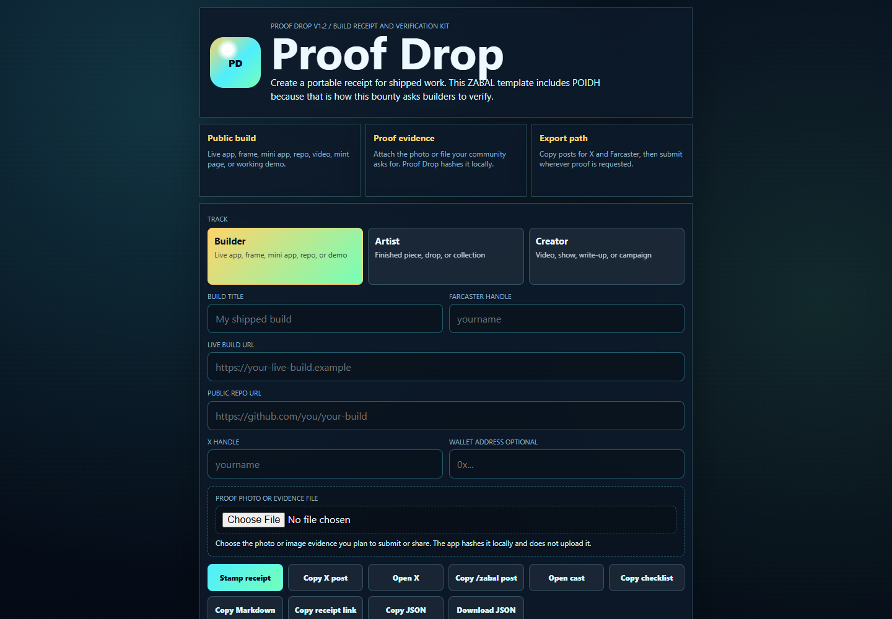

# Proof Drop

**Create a portable build receipt with a local SHA-256 evidence-file hash.**

[Open the app](https://proof-drop-zabal.pages.dev) | [Source](https://github.com/BrandonDucar/proof-drop-zabal)



Actual public interface captured October 9, 2026. An empty/default receipt is
not proof of shipped work.

## Make A Receipt

1. Enter a real build title and public build/repository links.
2. Select the evidence file you intend to share. Its hash is computed locally;
   the app does not upload the file.
3. Review the generated fields and copy or export the JSON receipt.
4. Submit through the destination your community requires, with human review.

A hash binds bytes; it does not establish authorship, ownership, truth, task
completion, or eligibility for payment. Missing evidence remains missing even
when a receipt has a hash.

## Origins And Scope

Originally built for ZABAL Gamez. The current template retains its POIDH claim
path, event fields, and suggested X/Farcaster copy. The July 2026 event details
are historical; check current organizer rules rather than assuming a bounty is
still open. The underlying portable receipt workflow is useful beyond that event.

The public interface also includes a browser-local gallery and an explicit
public-proof submission/feed surface. Local hashing is not the same as public
submission: review what you share and never include private source data.
This documentation update does not certify the remote feed or submission backend.

## Local Use

Open `index.html` in a browser, or serve the repository:

```bash
git clone https://github.com/BrandonDucar/proof-drop-zabal.git
cd proof-drop-zabal
npx serve .
```

For actual file hashing, use a secure browser context such as HTTPS or localhost.
Do not interpret generated social copy as a post that has been sent.

## Contributing

Useful improvements include accessibility, fixture-based verification tests, and
explicitly versioned event templates. Preserve ZABAL attribution and separate
generic receipt fields from event-specific requirements. Do not publish real
wallet/customer data in fixtures. No general redistribution license is declared
here; clarify licensing with the maintainer before reuse requiring permission.
